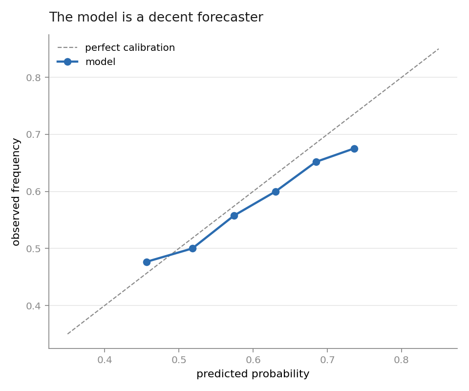
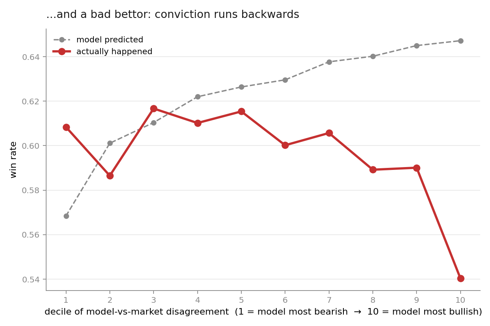
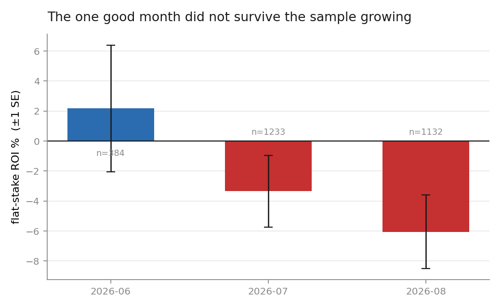
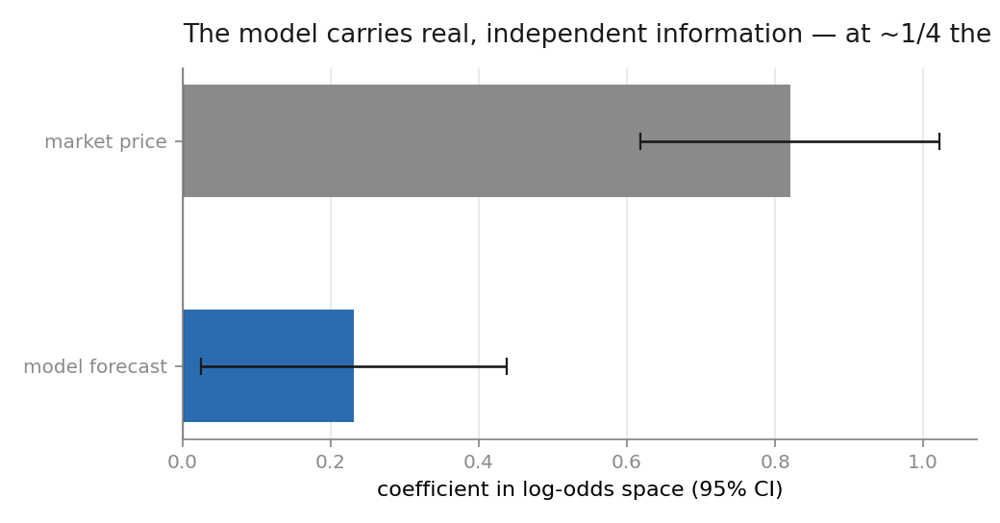

# I spent three months forward-testing my own baseball model. It failed. Here's the autopsy.

**Summary.** I built a Monte Carlo simulator that prices MLB hitter props from pitch-level
Statcast data, pre-registered a pass/fail gate for it, and ran it in shadow mode — logging
predictions against live sportsbook lines without placing money — for 87 days and **10,928
settled predictions**. The model turned out to be a *decent forecaster* and a *bad bettor*: its
probabilities were roughly calibrated, but the plays where it disagreed most with the market
were its worst-performing plays. A head-to-head regression against the market price showed why.
The model does carry statistically significant information beyond the closing line
(β = +0.23, z = 2.2) — but only about **22% of the weight** the edge calculation was implicitly
giving it. So it lost, systematically, in proportion to its own conviction.

It did not go live. This writeup is the reason it didn't.

---

## 1. What was built

A per-plate-appearance Monte Carlo simulator for hitter outcomes, built on:

- **7.8M pitches** of Statcast data, 2015–2025, ingested to a local Parquet archive
- **As-of-date feature stores** — pitcher stuff (CSW%, whiff%, velocity, spin) and hitter
  quality (xwOBA, K%, BB%, barrel%, split by handedness) across 7-day / 30-day / season /
  career windows, every row stamped `as_of = appearance_date − 1` so no feature can see
  its own outcome
- A **joint simulator** that plays out a game batter-by-batter and reads off the full joint
  (hits, runs, RBI) distribution per player, rather than summing independent marginals
- A **daily pipeline** on Windows Task Scheduler: refresh features, pull the slate, pull odds,
  simulate, log, settle yesterday

The interesting design choice is the joint simulation. Most public prop models estimate
P(hits ≥ 1) and P(runs ≥ 1) separately and multiply. Runs and RBI are strongly correlated
with teammates' outcomes in the same inning, so the product is wrong. Simulating the lineup
sequence gets the dependence structure for free. In backtest, the joint simulator beat the
component-summing baseline on Brier score — which is exactly the result that turned out not
to matter, for reasons in §5.

## 2. The gate, written down before the test

On **2026-05-30**, two days before the first prediction was logged, I wrote this into the
project's methodology document (v0.2.0, §8):

> Graduate the simulator to live firing only after N ≥ 200 shadow predictions accumulate with
> **mean CLV > 0** AND **calibration holding**. Falling short on CLV after N=200 is a finding,
> not a failure — it means the backtest edge did not survive contact with market prices, and
> the model needs attribution work before risking bankroll.

Two things about that paragraph matter more than anything else in this repo.

First, the bar is **CLV — closing line value — not profit.** Whether a bet won is mostly noise
at any realistic sample size. Whether the closing line moved toward your side is a much
higher-signal test of whether you knew something the market didn't. Grading on profit is how
people talk themselves into deploying noise.

Second, I wrote down in advance what a negative result would mean, so that when it arrived I
couldn't relitigate it. That is the whole point of pre-registration and it is the part of this
project I'd defend hardest.

## 3. Result one: it's a decent forecaster

87 days. 11,950 predictions logged, **10,928 settled** (877 voided for player DNP or
postponement, 145 still open at time of writing).

Aggregate: the model said **62.3%**, things happened **59.6%** of the time. Brier score
**0.2392**. Slightly overconfident — and drifting worse over the season, which is its own
finding — but the reliability curve tracks the diagonal across the range where the mass is.



| predicted | observed | n |
|---|---|---|
| 0.518 | 0.500 | 766 |
| 0.574 | 0.558 | 2,715 |
| 0.630 | 0.600 | 4,264 |
| 0.685 | 0.652 | 2,694 |
| 0.736 | 0.675 | 342 |

If the deliverable were "estimate the probability this hitter gets a hit," this is a working
model. It is not badly broken and it is not overfit into nonsense.

## 4. Result two: it's a bad bettor

Betting doesn't reward being right. It rewards being right *where the market is wrong*. So sort
every prediction by how far the model departed from the de-vigged market price, cut into
deciles, and look at what happened.



| decile | mean disagreement | model predicted | actually happened | ROI |
|---|---|---|---|---|
| 1 (most bearish) | −4.9% | 0.568 | **0.608** | −7.9% |
| 5 | +2.1% | 0.626 | 0.615 | −4.8% |
| 9 | +7.2% | 0.645 | 0.590 | −3.7% |
| 10 (most bullish) | +12.0% | 0.647 | **0.540** | −3.9% |

The predicted line climbs monotonically. The realised line *falls*. In the decile where the
model was most convinced the book was mispriced, it predicted 64.7% and delivered 54.0% — a
10.7-point gap, on n = 1,092.

This is the signature of a signal that is not merely weak but **inverted**: the magnitude of the
model's disagreement with the market is *information about the model's own error*, not about the
market's.

The pre-registered gate cohort — legs placed after the data pipeline was hardened, at flagged
edge ≥ 5% — is **n = 2,749, ROI −3.69% ± 1.59%.** More than two standard errors below zero, on
better than twice the sample the gate called for. And it degraded as the sample grew:



| month | n | ROI |
|---|---|---|
| June (post-hardening) | 384 | **+2.2%** ± 4.2 |
| July | 1,233 | −3.4% ± 2.4 |
| August | 1,132 | **−6.1%** ± 2.5 |

I want to draw attention to that first row, because it is the trap. On 2026-07-08 I ran an
interim review, saw +2.5% on n = 552, and wrote that the anti-predictive pattern had "weakened."
It hadn't. It was 0.7 standard errors of nothing, and it evaporated. If I had graduated the
model on that window I would have deployed a −4% ROI strategy with real money and told myself
the data supported it.

Meanwhile CLV — the actual gate criterion — never moved. Across the 964 legs with a captured
closing line, mean CLV is **+0.002%**. On the high-edge subset, **+0.009%** on n = 289. Zero, to
as many decimal places as anyone wants. The closing line never came toward these picks, which is
the market saying, quietly and repeatedly, that there was nothing there.

## 5. The diagnosis: it's a weighting error, not a broken model

A model can lose to the market for two very different reasons: it knows nothing, or it knows
something and is being used wrong. These have opposite remedies, so it's worth distinguishing
them properly rather than by vibes.

The test is a horse race. Regress the realised outcome on **both** forecasts simultaneously, in
log-odds space:

```
logit P(win) = a + b · logit(p_model) + c · logit(p_market)
```

If the model is pure noise, `b` collapses to zero once the market price is in the equation. It
doesn't:



| term | β | SE | z |
|---|---|---|---|
| model forecast | **+0.231** | 0.105 | **+2.20** |
| market price | **+0.820** | 0.103 | +7.98 |

The model contributes real, independent information at roughly 2.2 standard errors, *conditional
on already knowing the closing price*. That's not nothing — most retail models don't clear that
bar. But the relative weights say the model deserves about **22%** of the vote and the market
**78%**.

Now look at what the edge calculation was actually doing. `edge = p_model − p_market` treats the
two as **equally credible** — an implicit 50/50 weight on a forecast that earns 22%. The model
was being levered at roughly 2.3× its true strength, and the error scales with the size of the
disagreement. Which is precisely the pattern in §4: the bigger the departure from the market,
the bigger the over-weighting, the worse the result. Decile 10 is where the mis-specification is
maximal, and decile 10 is where the model dies.

Corroborating this: standalone Brier is 0.2392 for the model and **0.2371 for the market price
alone.** The market is simply the better forecaster of the two. The model's job was never to beat
it outright — only to add something on top — and the horse race says it does add something, just
far less than the edge formula assumed.

**So the correct conclusion is narrow and specific: the edge estimator is mis-specified, not the
model.** The right operator is a stacked blend with the measured weights,
`logit(p_final) = −0.04 + 0.231 · logit(p_model) + 0.820 · logit(p_market)`, with edge computed
off *that*. Under that blend the edges collapse toward zero and essentially nothing on this
market clears the vig — which is the honest answer, and a different sentence from "the model
doesn't work."

## 6. What I did about it

Nothing was ever wagered. The model has been in shadow mode since 2026-06-01 and remains there.

The less obvious work is settlement hygiene, which is where track records actually go to die.
Two examples from this log:

- **The silent-void bug.** Players get scratched. If a leg never settles, it sits in the log
  forever as a blank, and blanks are invisible in every summary statistic — so a record quietly
  drops its inconvenient rows. I added an explicit `void` path, gated on the game actually being
  final with boxscores ingested.
- **Then the void path over-fired.** A missed morning run made 79 real legs look unsettleable
  and voided them. I caught it, tightened the condition (postponed games never post as Final —
  they need an age-based rule instead), and shipped a **repair path** that flips false voids back
  once stats arrive. It recovered 73 of the 79.

That second one is the tell. The cheap move was to leave 79 legs voided; nobody would have known,
and the resulting record would have looked marginally cleaner. Rebuilding the rows was strictly
worse for the numbers and strictly better for the evidence.

## 7. What I'd tell you I got wrong

- **Concentration.** 10,821 of 10,928 settled legs are one market: hitter *over 0.5 hits*, the
  mainline. That is the most efficiently priced player prop on the board — I had written down
  before this test that I expected it to be unbeatable — and I spent three months proving it.
  The strategy I actually believed in was alternate lines, which the free odds tier doesn't
  carry. **The result is about that market, not about the model in general.** I tested the thing
  that was easy to test rather than the thing I wanted to know.
- **A threshold I moved mid-test.** The ≥1,200-leg re-cut point was added on 2026-07-08, during
  the test, right after observing the encouraging window. The original gate (N ≥ 200, CLV > 0)
  was pre-registered and is what actually binds; the later threshold is a researcher degree of
  freedom and I'm flagging it rather than quietly presenting it as part of the original design.
- **Noisy market prices.** Single book, free tier, one poll per game, two-way proportional
  de-vig. `p_market` has real measurement error, which attenuates the horse-race coefficients —
  the model's true `b` is probably somewhat higher than 0.231.
- **Calibration drift went unexamined.** Predicted-minus-observed was ~0.002 in June and ~0.074
  by August. I have a hypothesis (the simulator treats plate appearances as conditionally
  independent, so it understates game-level variance) and a partial fix that is implemented but
  disabled pending a proper variance fit. Unresolved.

## 8. What comes next

1. **Re-derive edge from the stacked blend** and re-run the gate on the corrected estimator.
   Expected outcome: near-zero edges on this market, which is the point.
2. **Decompose the high-edge misses** against what the market can see and the simulator can't —
   weather, umpire, bullpen rest, lineup slot, late scratches. The horse race says there is a
   missing feature; this is how to find it.
3. **Test the actual thesis.** Alternate lines, where the pricing is softer and 78% market
   weight may not hold.

## 9. Reproduce it

Everything above regenerates from the raw log:

```bash
pip install pandas numpy matplotlib
python analysis/reproduce.py
```

`data/shadow_log.csv` is the append-only prediction log — every leg, with the model's probability
and the book's price **as recorded before the game started**, timestamped. `analysis/reproduce.py`
computes every number in this document, including the regression (Newton–Raphson by hand, so the
arithmetic is inspectable rather than a library call). `results.json` is the output.

The model source — simulator, feature builders, methodology — is in a separate private repo.
What's here is the evidence, which is the part you'd want to check.
